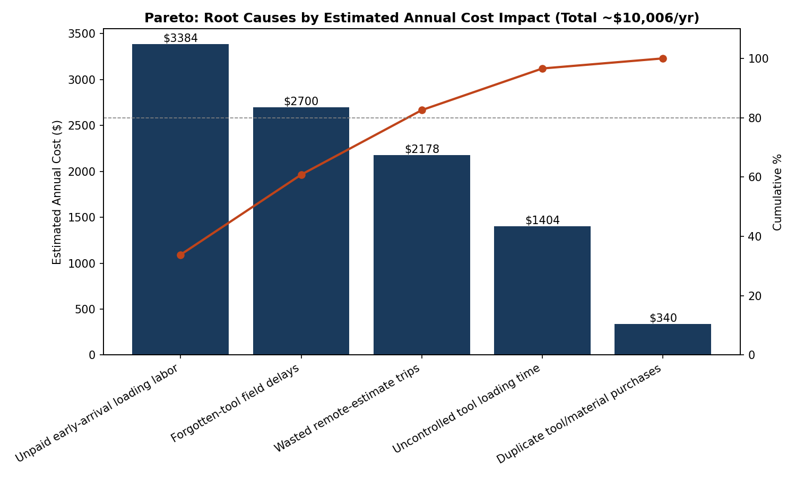
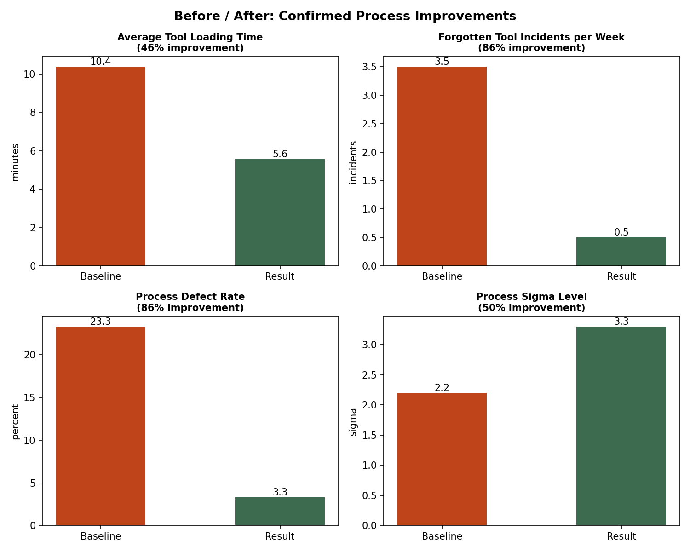

# Operations DMAIC case study: field-service tool loading

Lean Six Sigma DMAIC project for a two-person field-service business with recurring waste in pre-job tool preparation.

> **Privacy note:** This case study has been anonymized. The company name, owner name, and employee names have been removed, and the business's location and calendar dates have been generalized for public portfolio use. Quantified operational results (percentages, hours, dollar estimates) are preserved from the original engagement, since they represent the analytical content of this project. See [NOTES.md](NOTES.md) for the full list of what was changed and why.

## Define

**Business context:** a small regional landscaping and tree-service business (two field workers, two vehicles) providing tree trimming/removal, outdoor lighting installation, and general landscaping services in a mid-sized U.S. metro area.

**Problem statement:** the company had no standardized tool management or pre-job preparation process. Tools were stored without organization, job preparation relied entirely on memory, and forgotten tools caused frequent field delays - 3-4 incidents per week, each costing 30-60 minutes of delay.

**Goal statement:** reduce wasted field time, materials cost, and job execution errors by standardizing pre-job planning and tool loading - without new software, headcount, or capital investment, since the business operates as a lean, two-person, tablet-only operation.

**Scope:** tool storage and loading process, client estimate intake protocol, worker scheduling/synchronized start times, and materials/supply management by job type.

## Measure

Baselines were established through direct observation, an owner interview, and a review of vehicle/storage contents, using attribute-based measurement (checklist present/absent, loading time, tool correctness, gate-code availability). Key baseline figures:

- Average tool loading time: **10.4 minutes** per departure
- Forgotten-tool incidents: **3-4 per week**, each causing 30-60 minutes of field delay
- Estimated process defect rate: **23.3%** (~2.2σ)
- One confirmed **$121.11 wasted trip** from a phone-only remote estimate
- **20+ duplicate chainsaw chains** ($340+) discovered in disorganized storage

## Analyze

Fishbone (Ishikawa) diagramming, 5 Whys, and Pareto-style prioritization isolated the vital-few root causes driving wasted field time. All identified root causes were **process-design gaps** - not employee effort, demand variability, or equipment reliability - which is what made a low-cost, low-tech intervention the right fix rather than a staffing or capital investment.

The Pareto analysis below converts each root cause to an estimated annual dollar impact (hour-based waste converted at a consistent $18/hr labor rate) to rank them by what's actually worth fixing first - and the ranking is not the same as which problem is most *visible* day to day.

## Improve

All solutions were constrained to work within a low-tech, two-person operation. Alternatives considered and rejected: field-service scheduling software (cost/workflow overhead not aligned with the operation's needs), a full inventory management system (overkill for a two-person team), and adding a vehicle or staff member (would scale the existing waste rather than fix it).

**What was implemented (5S):**
- **Sort** - separated tools from clutter; this step alone surfaced the duplicate tool inventory.
- **Set in Order** - color-coded tool labeling by job type, labeled storage zones, laminated visual reference guides.
- **Standardize** - two vehicle binders with job-specific checklists, an estimate checklist, and a gate-code sheet.
- **Sustain** - in-person training for both workers on the full system.
- A standardized estimate protocol requiring photo/video confirmation for remote jobs, directly targeting the wasted-trip root cause.

## Control

Controls are embedded at the point of work - inside the vehicles, at the storage area, and during a weekly review - so sustaining the new process requires no extra administrative step that could lapse under time pressure. See `control-plan-summary.png` for the full breakdown of control mechanisms by monitoring frequency.

## Tools

Python (pandas, matplotlib) in Jupyter. The analysis and visuals use a small, sanitized, aggregated results dataset in `data/`, not raw business records.

## Results

- Loading time dropped about 46%, from 10.4 minutes to 5.6 minutes per departure.
- Forgotten-tool incidents dropped about 86%, from 3.5 per week to 0.5 per week. The estimated defect rate moved from 23.3% to 3.3%.
- The largest cost driver was unpaid early-arrival labor, estimated around $3,400 per year, not forgotten tools themselves.
- Total implementation cost: **~$40 in supplies**. ROI positive after a single prevented wasted trip.

## Visuals

Generated by the notebook and saved to `images/`:

| File | Shows |
|---|---|
| `process-timeline.png` | The ~4-month DMAIC engagement timeline |
| `root-cause-fishbone.png` | Ishikawa diagram of root causes by category |
| `issue-frequency-pareto.png` | Root causes ranked by estimated annual cost impact |
| `before-after-kpi-comparison.png` | Baseline vs. result for 4 key process metrics |
| `control-plan-summary.png` | Control mechanisms grouped by monitoring frequency |

## How to run

1. `pip install pandas matplotlib jupyter`
2. `jupyter notebook operations_dmaic_case_study.ipynb`
3. Run all cells top to bottom. Data loads from `data/` (two small sanitized CSVs, already included) and images are written to `images/`.

## Files

- `README.md` - this case study
- `operations_dmaic_case_study.ipynb` - full analysis (Define to Measure to Analyze to Improve to Control, with all visuals)
- `data/kpi_summary.csv` - sanitized before/after KPI values
- `data/annual_cost_impact.csv` - sanitized root-cause cost estimates
- `images/` - the 5 exported chart PNGs referenced above
- `NOTES.md` - anonymization log: what was changed, generalized, or removed, and why

## Limitations

- This is an anonymized case study, not a fictional one. It is based on a real small-business engagement with identifying details removed.
- Measurement was manually logged with stopwatch timing, self-report, and receipts. Some observer and reporting variance is unavoidable.
- The $18/hr labor rate used to convert hour-based waste into dollars comes from the original engagement and was not independently re-verified here.
- Results reflect one post-implementation measurement window. Sustained full-year results were not independently re-verified for this write-up.
