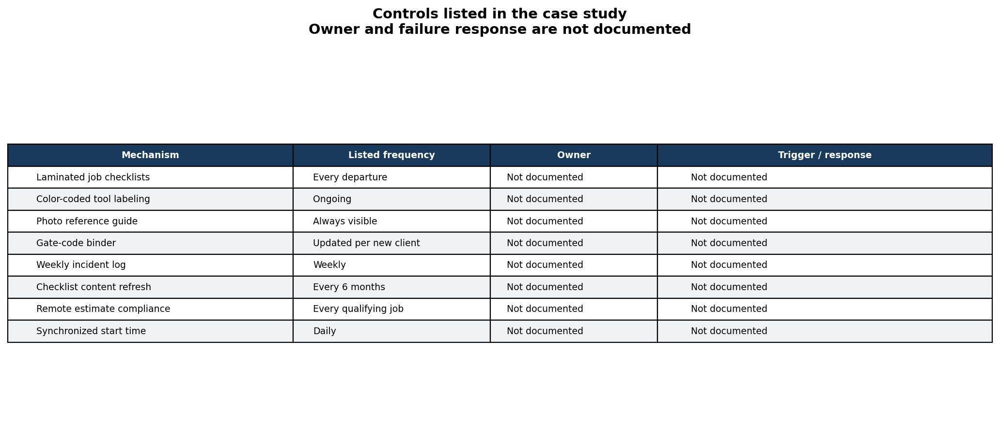

# Operations DMAIC case study: field-service tool loading

Lean Six Sigma DMAIC project for a two-person field-service business with recurring waste in pre-job tool preparation.

> **Privacy note:** This case study has been anonymized. The company name, owner name, and employee names have been removed, and the business's location and calendar dates have been generalized for public portfolio use. Quantified operational results (percentages, hours, dollar estimates) are preserved from the original engagement, since they represent the analytical content of this project. See [NOTES.md](NOTES.md) for the full list of what was changed and why.

## Define

**Business context:** a small regional landscaping and tree-service business (two field workers, two vehicles) providing tree trimming/removal, outdoor lighting installation, and general landscaping services in a mid-sized U.S. metro area.

**Problem statement:** the company had no standardized tool management or pre-job preparation process. Tools were stored without organization, job preparation relied entirely on memory, and forgotten tools caused frequent field delays - 3-4 incidents per week, each costing 30-60 minutes of delay.

**Goal statement:** reduce wasted field time, materials cost, and job execution errors by standardizing pre-job planning and tool loading, without new software, headcount, or capital investment. The public goal is qualitative; it does not set a numeric target or deadline.

**Scope:** tool storage and loading process, client estimate intake protocol, worker scheduling/synchronized start times, and materials/supply management by job type.

## Measure

Baselines were established through direct observation, an owner interview, and a review of vehicle/storage contents, using attribute-based measurement (checklist present/absent, loading time, tool correctness, gate-code availability). Key baseline figures:

- Timed tool loading: **10:23 before** and **5:34 after** in the reported controlled comparison. The source report separately describes normal morning loading as 20 to 30 minutes, so these are different baseline conditions.
- Forgotten-tool incidents: **3-4 per week**, each causing 30-60 minutes of field delay
- Estimated forgotten-tool incident rate: **23.3% of departures**, assuming about 15 departures per week and one defect opportunity per departure. The source does not establish whether multiple incidents could occur on one departure.
- One confirmed **$121.11 wasted trip** from a phone-only remote estimate
- **20+ duplicate chainsaw chains** ($340+) discovered in disorganized storage

## Analyze

Fishbone (Ishikawa) diagramming, 5 Whys, and a cost ranking were used to organize the observed failure points and identify likely process causes. The summary data does not independently rule out staffing, demand, or equipment factors, so these categories reflect the project team’s analysis rather than tested exclusions.

The chart ranks rough annual cost estimates. Several categories may overlap, and the estimates rely on owner reports, projected annual frequencies, and an $18/hour labor rate. They should not be added together as savings. The project source gives two unpaid-loading estimates: $3,375 from 187.5 hours at $18/hour, and $1,125 in a separate benefits table. The CSV uses the formula-based amount; the conflict remains unresolved.

## Improve

All solutions were constrained to work within a low-tech, two-person operation. Alternatives considered and rejected: field-service scheduling software (cost/workflow overhead not aligned with the operation's needs), a full inventory management system (overkill for a two-person team), and adding a vehicle or staff member (would scale the existing waste rather than fix it).

**What was implemented (5S):** The source report describes all five practices.
- **Sort** - separated tools from clutter; this step alone surfaced the duplicate tool inventory.
- **Set in Order** - color-coded tool labeling by job type, labeled storage zones, laminated visual reference guides.
- **Shine** - a post-job cleaning and tool-return routine.
- **Standardize** - two vehicle binders with job-specific checklists, an estimate checklist, and a gate-code sheet.
- **Sustain** - in-person training for both workers on the full system.
- A standardized estimate protocol requiring photo/video confirmation for remote jobs, directly targeting the wasted-trip root cause.

## Control

The report lists eight controls with methods and frequencies, including a weekly incident log. It also includes a blank tracking form, but no completed log was found in the archived project materials. The control plan does not name an owner, set trigger limits, or describe a response when a check fails, so it does not show whether the controls operated or kept results on target.

## Tools

Python (pandas, matplotlib) in Jupyter. The notebook rebuilds charts from sanitized, aggregated summary values in `data/`. It cannot recalculate the reported results because the observation logs are not included.

## Results

- In the reported timed comparison, loading took 10:23 before and 5:34 after, a 46% reduction. The source describes a controlled timed test, not a repeated sample, and separately reports typical loading as 20 to 30 minutes.
- The reported forgotten-tool frequency moved from an estimated 3 to 4 incidents per week to 0 to 1 (averages of 3.5 and 0.5). The 23.3% and 3.3% rates assume about 15 departures each week and treat incidents as distinct departure-level defects; the report includes a blank weekly tracking form, but no completed log or departure-level denominator was found in the archived project materials.
- The source estimates unpaid early-arrival labor at about 188 hours per year. Its report gives inconsistent dollar figures for this item ($3,375 in the calculation and $1,125 in the benefits table), so the dollar impact is unresolved.
- Total implementation cost: **about $40 in supplies**. The source estimates a confirmed wasted trip at $121.11, but does not document a post-change avoided trip; positive realized ROI is therefore not established.

## Visuals

Generated by the notebook and saved to `images/`:

| File | Shows |
|---|---|
| `process-timeline.png` | The ~4-month DMAIC engagement timeline |
| `root-cause-fishbone.png` | Ishikawa diagram of root causes by category |
| `issue-frequency-pareto.png` | Ranked estimates by category; amounts may overlap |
| `before-after-kpi-comparison.png` | Three reported before/after measures; source logs are unavailable here |
| `control-plan-summary.png` | Listed mechanisms with undocumented owner and failure response |

## How to run

1. `pip install pandas matplotlib jupyter`
2. `jupyter notebook operations_dmaic_case_study.ipynb`
3. Run all cells top to bottom. Data loads from `data/` (two small sanitized CSVs, already included) and images are written to `images/`.

## Files

- `README.md` - this case study
- `operations_dmaic_case_study.ipynb` - full analysis (Define to Measure to Analyze to Improve to Control, with all visuals)
- `data/kpi_summary.csv` - sanitized before/after KPI values
- `data/annual_cost_impact.csv` - sanitized annual cost estimates; categories may overlap
- `images/` - the 5 exported chart PNGs referenced above
- `NOTES.md` - anonymization log: what was changed, generalized, or removed, and why

## Limitations

- This is an anonymized case study, not a fictional one. It is based on a real small-business engagement with identifying details removed.
- Measurement was manually logged with stopwatch timing, self-report, and receipts. A blank weekly tracking form appears in the source report, but no completed underlying logs, sample sizes, or post-change observation window were found in the archived project materials. The before/after changes therefore cannot be independently recomputed here.
- The reported sigma levels (about 2.2 and 3.3) are numerically consistent with a 1.5-sigma shift applied to the estimated departure-level defect rates, but the source does not state the convention or establish that each incident maps to a separate defect opportunity. Treat them as source-reported estimates, not validated process capability results.
- The $18/hr labor rate used to convert hour-based waste into dollars comes from the original engagement and was not independently re-verified here.
- Results reflect one post-implementation measurement window. Sustained full-year results were not independently re-verified for this write-up.
